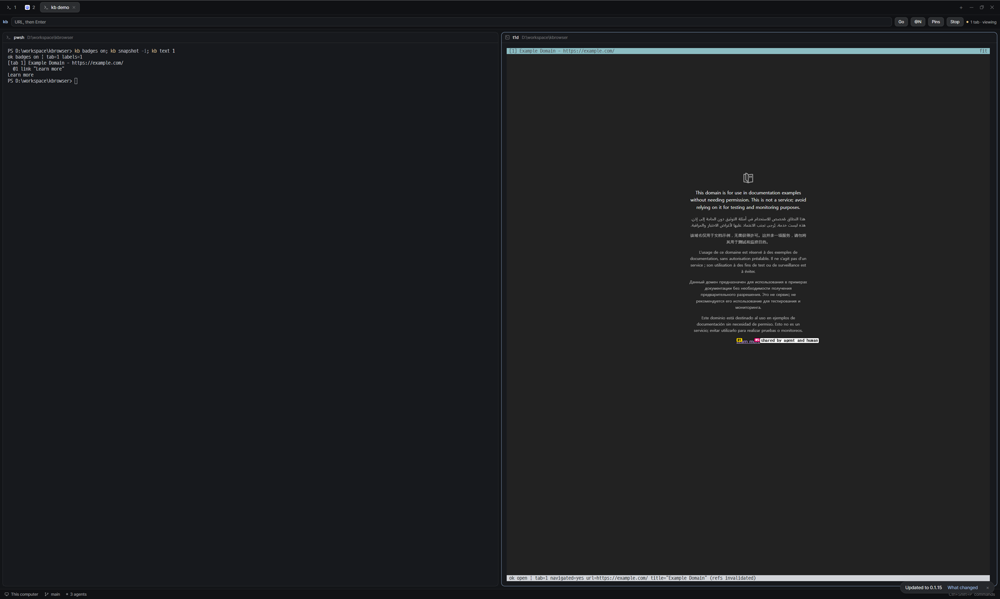

# kb

A terminal browser that an AI agent and a human drive at the same time.

The agent uses a CLI: `kb snapshot` prints the page as an accessibility tree
with numbered refs, and `kb click 3` acts on one. The human runs `kb view` and
sees the same tabs live in the terminal, with mouse and keyboard going to the
page. Both sides talk to one background daemon that owns a Chrome instance
over the Chrome DevTools Protocol.

The part that is specific to kb is **pins**: the human right-clicks an element
in the viewer and types a note; the agent reads the note together with the
element's ref, selector, role, text and position.

```text
$ kb pins
# kb pins (1)

## #1 this link should open in a new tab
- page: Example Domain - https://example.com/
- element: link "Learn more" (ref @1, tab 1)
- selector: `html > body > a`
- text: "Learn more"
- box: 583,715 83x21 in 1264x705
- created: 2026-11-13T14:06:05Z
```

So instead of describing "the blue button under the second table" in a prompt,
you point at it.

## Install

Download a build from the
[releases page](https://github.com/stardino2lab/kbrowser/releases/latest)
(Windows x64, Linux x64), unpack it and put `kb` on your PATH. `SHA256SUMS` on
the same page lists the checksums.

Or build it yourself. Requirements:

- Rust (stable) to build
- Chrome, Chromium or Edge installed. kb looks in the usual locations; set
  `KB_CHROME` to an executable to override.
- Windows or Linux. Both are tested. The code has a macOS path, but it has
  never been run there.

```bash
cargo install --git https://github.com/stardino2lab/kbrowser
```

Or, from a clone: `cargo install --path .`

This installs a single binary, `kb`. The crate has no dependencies: JSON,
WebSocket and the CDP client are implemented in the repository.

## Agent usage

The daemon and a headless Chrome start on the first command.

```text
$ kb open https://example.com
ok open | tab=1 navigated=yes url=https://example.com/ title="Example Domain" (refs invalidated)

$ kb snapshot -i
[tab 1] Example Domain - https://example.com/
  @1 link "Learn more"

$ kb click 1 --snapshot
ok click @1 link "Learn more" | tab=1 navigated=yes url=https://www.iana.org/help/example-domains title="Example Domains" (refs invalidated)
[tab 1] Example Domains - https://www.iana.org/help/example-domains
  @2 link "Homepage"
    image "Homepage"
  @3 link "Domains"
  ...
```

What an agent can rely on:

- **Refs are stable.** A ref keeps its number for as long as its element
  exists. It goes stale when the element is removed or the page navigates, and
  the command says so instead of clicking something else.
- **Input is real.** `click`, `fill` and `press` send trusted browser events.
  `click` scrolls the element into view and fails if it is covered, hidden or
  disabled.
- **Errors are a contract.** Errors go to stderr as `error[code]: message`
  with a `hint:` line, or as JSON with `--json`. Exit codes:

  | Code | Meaning |
  |------|---------|
  | 0 | ok |
  | 1 | usage |
  | 2 | stale ref |
  | 3 | daemon or Chrome failure |
  | 4 | timeout |
  | 5 | not actionable (covered, hidden, disabled) |
  | 6 | no such tab |
  | 7 | JavaScript exception |
  | 8 | dialog open |

- **Output is bounded.** `snapshot` caps at 2000 nodes and marks truncation.
  Narrow it with `-i` (interactive elements only), `--scope <ref>` or
  `--max-nodes <n>`.

Main commands:

| Command | What it does |
|---------|--------------|
| `open <url>` | navigate and wait for load |
| `snapshot` | accessibility tree with `@N` refs |
| `text [ref]` | visible text of the page or one element |
| `click <ref>`, `fill <ref> <text>`, `press <key>` | input |
| `wait <text\|ref>` | wait until it appears (`--gone`: disappears) |
| `eval <js>` | run JavaScript, print the result |
| `screenshot <file.png>` | save the viewport |
| `tabs`, `tab new [url]`, `tab <id>`, `tab close [id]` | tabs |
| `dialog accept [text]`, `dialog dismiss` | answer alert/confirm/prompt |
| `badges on\|off` | draw each `@N` on the page itself |
| `pins`, `pin add <ref> <note>` | read and write pins |
| `status`, `stop` | daemon |

`kb help` prints the full reference.

Write refs as plain numbers (`kb click 3`). `@3` also works, but PowerShell
swallows a bare `@3`.

## Human usage

```bash
kb view https://example.com
```

`kb view` streams the page into the terminal and forwards mouse and keyboard.
It shares tabs with the CLI, so you watch what the agent does and the agent
sees what you do.

It needs a terminal with the kitty graphics protocol: Kitty, Ghostty, WezTerm
or Herdr. `kb view --probe` reports what your terminal supports.

The leader key is `Ctrl+G` or `Ctrl+B` (`--leader <letter>` to change it).

| Keys | Action |
|------|--------|
| leader `1` / `2` / `4` | one tab, 1x2, or 2x2 layout |
| leader arrows | move between panes |
| leader `z` | zoom (layout viewport width) |
| leader `l` | enter a URL |
| leader `t` / `w` / `n` / `p` | new, close, next, previous tab |
| leader `r`, `[`, `]` | reload, back, forward |
| leader `a` | toggle `@N` badges |
| leader `m` then click | pin a note on an element |
| leader `s` | save pins to `kb-pins.md` and `kb-pins.json` |
| leader `?` | help |
| leader `q` | quit |

Right-click or Alt+click an element also pins it. Inside tmux, Herdr and
similar multiplexers, `Ctrl+B` and the right mouse button usually belong to
the multiplexer; use `Ctrl+G` and leader `m`.

## Herdr layout

[herdr-kb-browser](https://github.com/stardino2lab/herdr-kb-browser) is a
layout for [Herdr](https://herdr.dev): Herdr's main window with a browser
address bar under the tabs. Type a URL and press Enter, and `kb view` opens in
a pane beside the agent's terminal.



## Limits

- Cross-origin iframes are not in the snapshot yet. They show up as a note.
- The viewer does not work in terminals without kitty graphics, which includes
  Windows Terminal and the default macOS Terminal. The CLI works everywhere.
- kb drives its own Chrome profile. It does not attach to the browser you
  already have open.
- CDP only, so Chromium-based browsers only.
- Chrome's debugging port is open on localhost while the daemon runs. `kb stop`
  closes it.
- The translations were not reviewed by native speakers.

## Configuration

| Variable | Meaning |
|----------|---------|
| `KB_HOME` | state directory |
| `KB_CHROME` | browser executable |
| `KB_HEADED=1` | show the browser window |
| `KB_LANG` | interface language: `en ko ja zh es fr de` |

`kb lang <code>` sets the language permanently. Command output, JSON and error
codes are always English, whatever the language.

## Development

```bash
cargo test
```

The end-to-end tests launch a daemon and a headless Chrome each, so they need
a browser installed.

## License

MIT. See [LICENSE](LICENSE).
