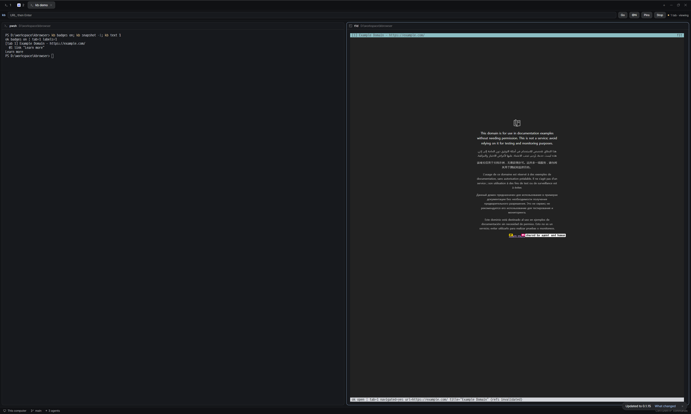

# kb browser

Herdr's main window with a browser address bar under the tabs. Type a URL and
press Enter: the page opens in a live browser pane to the right of your
terminal, drawn inside the terminal by `kb view`. The agents in the other panes
drive that same browser with `kb` commands, so you watch what they click, and
they read the notes you pin on the page.



## What you see

Left to right, top to bottom, the window is Herdr's shipped `main` layout with
one extra strip:

- **Sidebar** (268px, `chrome`): brand strip, spaces, agents, footer. Unchanged.
- **Tab bar** (42px): unchanged.
- **kb bar** (40px, `chrome`, 1px `border` line under it), new. In one row,
  8px apart, 10px side padding:
  - `kb` in `accent`, 12px semibold.
  - a text field that takes the rest of the width: 26px high, radius 7,
    `background` fill, 1px `input` border that turns `accent` while it has the
    keyboard, 12.5px text, placeholder "URL, then Enter".
  - four buttons, 26px high, radius 7, `raised` fill, 1px `border`, 12px medium
    text: **Open** (reads **Go** while a viewer is showing), **@N**, **Pins**,
    **Stop**. A button that cannot act now has `dim` text and no hover.
  - a 6px dot and 11.5px `muted` text: the browser's state.
- **Work area**: the shown tab's panes as cards (radius 10, 8px gap, 30px pane
  header), with the Files / Changes panel on the right. Unchanged.
- **Status bar** (28px): unchanged.

The browser itself is an ordinary terminal pane running `kb view`: a cyan title
row (tab number, page title, URL, zoom), the page as a picture, and a one-line
status row at the bottom.

## How it behaves

- **Enter in the field, or Open**: with no viewer on screen, splits the focused
  pane to the right and runs `kb view <url>` there. With a viewer already
  showing, runs `kb open <url>` so the page loads in the existing viewer. An
  empty field opens `props.home`.
- **@N** toggles yellow `@1`, `@2`, ... badges on every element an agent can
  act on (`kb badges toggle`). They are the same numbers `kb snapshot` prints.
- **Pins** writes the notes pinned on the page to `kb-pins.md` in the focused
  pane's folder (`kb pins --save kb-pins.md`) and shows a toast with the count.
- **Stop** shuts the browser down (`kb stop`). The viewer pane closes with it.
- **State text**, asked every 5 seconds with `kb status --json` (which never
  starts a browser): `1 tab · viewing` with a `working`-colored dot when a
  viewer is attached, `2 tabs · headless` when agents use it with no viewer,
  `browser stopped` with a `dim` dot, `kb not installed` with a `blocked` dot.
- A button shows `…` while its command runs. A command that fails posts an
  error toast with the first line of what `kb` said.
- Agent statuses (working, blocked, done, idle) look as they do in `main`: the
  bar does not show them.
- Inside the viewer pane, mouse and keys go to the page. `Ctrl+G` is its
  leader key: `Ctrl+G` then `m`, then a click, pins a note at that spot;
  `Ctrl+G` `2` / `4` splits the viewer into two or four browser tabs; `Ctrl+G`
  `q` quits it. Herdr keeps `Ctrl+B` and the right mouse button, which is why
  the viewer uses these.

## Built from

- `layouts/kb-browser.json`: a copy of the shipped `main` layout's tree with
  one node added as the second child of `work`, between `tabs` and `work-body`:

  ```json
  { "id": "kb-bar", "type": "block", "size": { "px": 40 },
    "content": { "mod": "kb-browser", "props": { "kb": "kb", "home": "https://example.com" } } }
  ```

  Every other block points at Herdr's shipped mods (`workspace-chrome`,
  `spaces`, `agents`, `tabs`, `pane`, `files`, `changes`, `workspace-status`).
- `mods/kb-browser/` (`mod.json`: `{ "place": "none" }`): the bar. Props:
  `kb` = the program to run (default `"kb"`, found on PATH), `home` = the page
  an empty field opens.
- `herdr` functions: `exec` (runs `kb`), `run("pane.split", { direction:
  "right", argv })`, `theme`, `props`, `focused` (its `cwd` is where commands
  run and where pins are saved), `notify`. From `gpui-base`: `h_flex`,
  `InputState`, `Input`. One `cx.timer.every(5000)` for the state text; no
  animation.
- **Programs it runs:** `kb` only, from
  https://github.com/stardino2lab/kbrowser (a single Rust binary, no
  dependencies; `cargo install --git https://github.com/stardino2lab/kbrowser`).
  `kb` starts a background daemon and a headless Chrome on first use, so Chrome,
  Chromium or Edge must be installed. The mod itself reaches no network and
  reads no files.

## Watch out

- The viewer needs a terminal with kitty graphics. Herdr's terminals have it.
- `kb status --json` gained the `viewers` field with this layout; with an older
  `kb` the bar never sees a viewer and Open always splits a new pane.
- "A viewer is showing" means any viewer attached to the daemon, in any tab or
  window. Go then loads the page into `kb`'s current browser tab, which is the
  one a single-pane viewer shows; with a 2- or 4-pane viewer it may be a pane
  other than the one you are looking at.
- `exec` rejects when `kb` is not on PATH: catch it, or the bar stays blank.
  Set `props.kb` to a full path instead of changing PATH if you prefer.
- Do not poll faster than a few seconds: each check starts a process.
- Do not start `kb view` from `exec`: it needs a terminal. Use `pane.split`
  with `argv`.
- The layout is a copy of `main` at the time it was made. When Herdr's `main`
  gains blocks, this copy does not; rebuild it from the current `main` plus the
  one node above.
- `kb` runs Chrome with a debugging port open on localhost for as long as the
  daemon lives. Press Stop when done.

## Done when

- `herdr-app check mods/kb-browser` passes and `layouts/layout.error` is absent
  after `layout.switch {"name":"kb-browser"}`.
- With the browser stopped, the bar reads `browser stopped`; Open and the field
  work, the other three buttons are dim.
- Typing `example.com` and Enter opens a pane on the right that shows the page
  within a few seconds, and the bar reads `1 tab · viewing`.
- With that viewer open, typing another URL and Enter changes the page in the
  same pane, without a second pane appearing.
- `kb snapshot -i` in the left pane lists `@1 link "Learn more"`, and @N draws
  a yellow `@1` on that link in the viewer.
- Stop closes the viewer pane and the bar returns to `browser stopped`.
